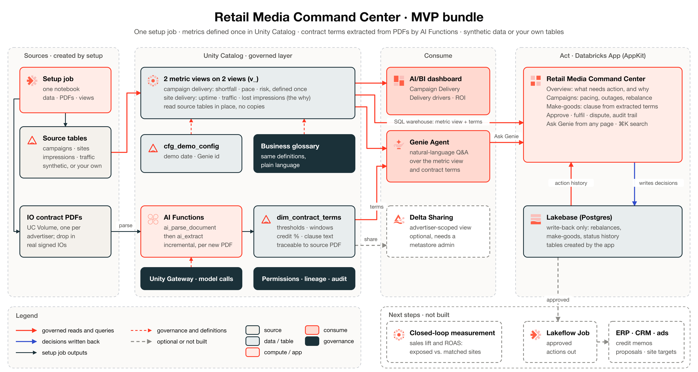

# Architecture



## Data flow

1. **Sources.** These are 5 tables:
   - `dim_campaigns`, `dim_sites`, `dim_campaign_sites`
   - `fact_pump_impressions`, `fact_site_daily_activity`

   The setup job generates them from `config/seed_config.yml`, or you point the bundle at your own.
2. **Governed layer (Unity Catalog).**
   - `v_campaign_delivery` defines delivered, shortfall, pace and risk **once**, as of `cfg_demo_config.as_of_date`.
   - `v_campaign_site_daily` puts impressions next to their drivers: fuel transactions and screens online.
   - Two metric views sit on top: `metric_view_campaign_delivery` and `metric_view_site_delivery`.
   - The app, the dashboard and Genie all read these objects, so every surface shows the same numbers.
3. **Contracts.**
   - Signed IO PDFs live in the `contracts` volume. `ai_parse_document` and `ai_extract` turn them into `dim_contract_terms`.
   - Extraction is incremental: only new or changed files get an AI call.
   - Make-good terms exist **only** in the PDFs; nothing seeds them.
4. **Consume.** The AI/BI dashboard and the Genie space read the metric views. Genie also reads the contract terms.
5. **Act.**
   - The Databricks App reads governed data through the SQL warehouse.
   - It writes operational decisions to Lakebase (`app_ops`): rebalances, make-goods and status history.

## How the synthetic data explains itself

Impressions are **derived**, not assigned:

```
impressions(campaign, site, day) = fuel_transactions x (screens_online / screens_installed) x campaign share x noise
```

Each campaign is then scaled to its configured delivered total. The demo's "why" answers come from those drivers, and no table has a "reason" column:

| Question | Driver in the data | What it supports in the app |
| --- | --- | --- |
| Why is FizzCo Summer Fuel-Up behind? | A 3-week screen outage at its highest-traffic Southwest sites; every Southwest campaign dips in the same weeks | Make-good (the loss is on the retailer's side and too late to recover) |
| Why is Holiday Refresh critical with 10 days left? | Creative approved 5 days after flight start (no impressions before), and a suburban-heavy site plan | Rebalance toward high-traffic sites |
| Why do suburban sites underperform? | Suburban sites get 10–30x fewer fuel transactions; screen uptime is the same | It's traffic, not screens, which is why rebalancing works |

## Design decisions

- **One definition of the numbers.** Business rules live in `v_campaign_delivery` and the metric views, not in the app, the dashboard or the job.
- **Uploaded contracts.** The Contract tab writes a PDF to the contracts volume and runs the same `ai_parse_document` + `ai_extract` spec the setup job uses (read from `cfg_demo_config.extract_spec`), as the app's service principal. Terms land in `dim_contract_terms`, which Genie and the make-good drawer already read, so nothing else changes.
- **No copies of governed data.** The app reads Unity Catalog through the SQL warehouse, so there are no snapshot tables, synced tables or refresh job. Lakebase holds only what the app writes.
- **Why server-side reads.** Every screen merges governed numbers with the app's own action history in Lakebase. Write routes also validate against governed data, for example taking shortfall from Unity Catalog and never from the browser. So the server runs the warehouse queries (statement execution API, 60-second cache) and keeps the same `/api` contract for the React client.
- **Genie is created by setup, not the bundle.** Genie rejects a space whose tables don't exist yet. Setup creates or updates the space, grants access, and stores its ID in `cfg_demo_config`; the app reads it at startup.
- **Cloud-neutral.**
  - Serverless jobs and a SQL warehouse only, with no cluster or instance types.
  - Managed tables and volumes only, with no cloud storage paths.
  - The same bundle deploys to Azure Databricks and Databricks on AWS. Only `targets/*.yml` differ.

## Repository layout

```
databricks.yml              variables + includes
targets/azure.yml           workspace-specific values (add your own targets/*.yml)
resources/                  app, setup job, dashboard, schema + volume + Lakebase
config/seed_config.yml      synthetic data, stories, contracts, demo seed rows
src/notebooks/setup.py      the one setup notebook (preflight -> data -> PDFs -> views -> extraction -> Genie -> checks)
src/app/                    Databricks App (AppKit: Node server + React client)
src/dashboards/             AI/BI dashboard definition
scripts/check_anonymized.sh fails on real brand names, people or internal identifiers
```

## Next steps (not built)

- **Closed-loop measurement:** sales lift and ROAS from in-store sales at exposed vs. matched comparison sites, as a metric view next to delivery.
- **Push approved actions out:** a Lakeflow job sends approved make-goods and site targets to ERP, CRM and the ad server.
- **Share with advertisers:** an advertiser-scoped view over `v_campaign_delivery`, shared live with Delta Sharing (see `DEMO_GUIDE.md`).
