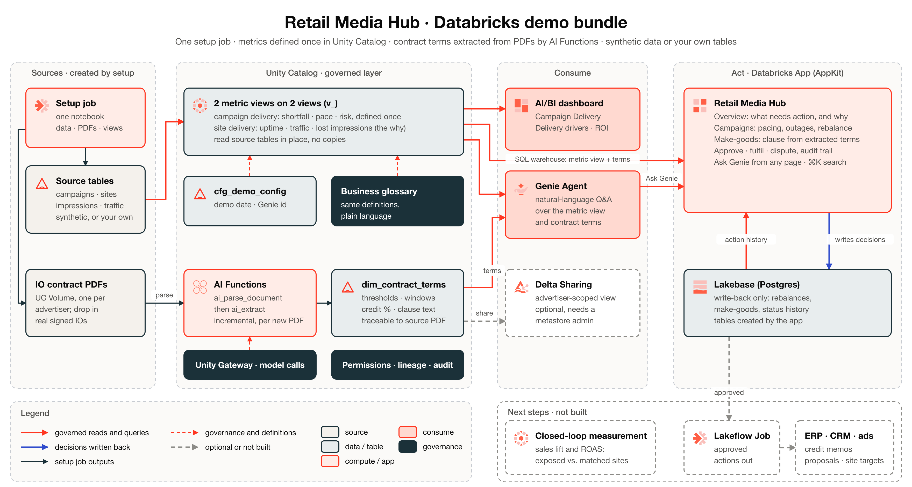

# Retail Media Hub

A deployable demo of a retail media operations app on Databricks:

- **See what needs action today** and why delivery moved.
- **Rebalance** daily site targets.
- **Log and approve make-goods** backed by terms extracted from signed IO PDFs.
- **Ask Genie** why delivery fell short.

It runs on synthetic data by default. Every number comes from one governed metric layer in Unity Catalog.



The whole deployment is one Declarative Automation Bundle (DAB). Follow the steps below in order, and copy the commands exactly. Replace anything in `<angle brackets>`.

- `DEMO_GUIDE.md`: a scripted walkthrough with the expected numbers.
- `ARCHITECTURE.md`: how it fits together.

---

## 1. Prerequisites

**On your computer**
- `git`
- Databricks CLI **v1.17 or later** (the version this was tested with). Check with:
  ```bash
  databricks --version
  ```
  Install or upgrade: <https://docs.databricks.com/dev-tools/cli/install.html>. On macOS:
  ```bash
  brew tap databricks/tap && brew install databricks
  ```

**In the Databricks workspace** (send this list to your workspace admin if you aren't one)
- [ ] Unity Catalog, with **serverless compute** for notebooks and jobs.
- [ ] A **catalog** where you can create a schema (`USE CATALOG` + `CREATE SCHEMA`).
- [ ] A **Pro or Serverless SQL warehouse** you can use. *Not* a Lakehouse RT warehouse: it can't query metric views.
- [ ] **Databricks Apps** enabled, and the **Apps user authorization** preview turned on (Settings > Previews). Genie in the app runs as the signed-in user.
- [ ] **Lakebase** (autoscaling Postgres) available in the workspace region.
- [ ] **AI Functions** `ai_parse_document` and `ai_extract` available in the region, or cross-geography processing enabled.
- [ ] **Genie** enabled.

The setup job checks most of these first and stops with a plain message if one is missing.

---

## 2. Get the code

The repository is public; no GitHub account is needed.

```bash
git clone https://github.com/abrewers/retail-media-hub.git
cd retail-media-hub
```

No git? Download the ZIP from the repository page (**Code > Download ZIP**) and unzip it.

All commands below run from this folder. On Windows, run them in WSL or Git Bash.

## 3. Log in to the workspace

```bash
databricks auth login --host https://<your-workspace-host> --profile retail-media-hub
databricks current-user me --profile retail-media-hub        # should print your user
```

Use your workspace URL, for example `https://adb-1234567890123456.7.azuredatabricks.net` on Azure or `https://<name>.cloud.databricks.com` on AWS.

## 4. Configure and deploy with the setup script (recommended)

```bash
./scripts/configure.sh
```

The script walks you through everything below and asks before it changes anything:

1. **Workspace:** pick one of your CLI profiles, or sign in to a new workspace URL.
2. **SQL warehouse:** pick from a list. A serverless Pro warehouse is marked as recommended, and Lakehouse RT warehouses are left out because they can't query metric views.
3. **Catalog:** pick one you can create a schema in.
4. **Names** for the schema, app and Lakebase project. The script suggests free names when a default is already taken.
5. **Optional settings,** each with a recommendation: the retailer name shown in the app, demo date, synthetic data or your own tables, and who can see it.
6. It writes `targets/<name>.yml`, validates, and then offers to **deploy**, **run setup** and **start the app**.

Answer **yes** to all three at the end, then go to **step 9**. If you'd rather run the steps yourself, answer no; the script prints the three commands. You can also skip the script entirely and follow steps 4a–8 by hand.

## 4a. (Manual) Look up two values

**SQL warehouse ID.** Pick a `PRO` or serverless warehouse, not one whose type is `REALTIME`:
```bash
databricks warehouses list --profile retail-media-hub
```

**Catalog.** Pick one you can create a schema in:
```bash
databricks catalogs list --profile retail-media-hub
```

## 5. (Manual) Create your target file

A target holds the values for one workspace. Copy the template:

```bash
cp targets/azure.yml targets/mine.yml
```

Open `targets/mine.yml` and replace its contents with the following. Fill in the four values in `<angle brackets>`.

```yaml
targets:
  mine:
    workspace:
      host: https://<your-workspace-host>
    variables:
      catalog: <your-catalog>
      warehouse_id: "<your-warehouse-id>"
      # Names must be unique in the workspace. Change them if this demo is already deployed there.
      schema: retail_media
      app_name: retail-media-hub         # lowercase, hyphens, 26 characters max
      lakebase_project: retail-media-hub-ops
```

Every command below passes `-t mine`, so you don't need to touch `targets/azure.yml`.

> **Testing in a workspace that already has this demo?** Use different names, for example `schema: retail_media_test`, `app_name: retail-media-hub-test`, `lakebase_project: retail-media-hub-test-ops`. Otherwise the deploy fails, because the app or Lakebase project name is taken.

Optional variables (defaults in `databricks.yml`):

| Variable | Default | Meaning |
| --- | --- | --- |
| `as_of_date` | empty = the day setup runs | The demo's "today" (`YYYY-MM-DD`) |
| `generate_data` | `true` | `false` = use your own source tables (see *Connect real data*) |
| `source_catalog` / `source_schema` | same as `catalog` / `schema` | Where the source tables live |
| `viewer_group` | `users` | Group given read access to the data and the Genie space; empty = nobody else |
| `retailer_name` | empty = *Waypoint Fuel & Market* (fictional) | Your retailer's name: app header, browser tab, initials logo, store names, own-brand campaigns and the publisher on the contract PDFs. Change it, then re-run steps 7 and 8 |

## 6. Validate and deploy

```bash
databricks bundle validate -t mine --profile retail-media-hub     # expect: Validation OK!
databricks bundle deploy -t mine --profile retail-media-hub
```

`deploy` creates the schema, the contracts volume, the Lakebase project, the app, the setup job and the dashboard. It takes 1–3 minutes.

## 7. Run setup

```bash
databricks bundle run setup -t mine --profile retail-media-hub
```

This takes about 5–10 minutes. It generates the data and the IO contract PDFs, builds the views and metric views, extracts the contract terms with AI Functions, creates the Genie space, grants access, and runs checks. The command prints a run URL; open it to watch progress. It ends with `TERMINATED SUCCESS`.

If it fails, open the run URL: the preflight and validation tables say what's wrong (see *Troubleshooting*).

## 8. Start the app

```bash
databricks bundle run app -t mine --profile retail-media-hub
```

It ends with `You can access the app at https://...`. Open that URL. The first time, approve the **Permission Requested** prompt; that lets Genie in the app run as you.

## 9. Check it works

| Where | You should see |
| --- | --- |
| Sidebar and browser tab | Your `retailer_name` (or *Waypoint Fuel & Market*) with its initials as the logo |
| **Overview** | 35 active campaigns, **$242.9K** make-good exposure, **8** at risk (2 critical), **2** over-delivering; 8 cards under *Needs action today* |
| Overview: **FizzCo Summer Fuel-Up** card | 3 days left, button **Prepare make-good** |
| Overview: **FizzCo Holiday Refresh** card | Critical, 10 days left, button **Rebalance now · recovers ~$1.5K** |
| Overview: *Why delivery dipped* | Southwest screens mostly offline about 6 weeks before the demo date, at 15 sites (about 33% online) |
| **Campaigns** | 35 active; filter *Critical* shows 2; search `fizzco` shows 3 |
| Campaign **FizzCo Holiday Refresh** > Pacing | A shaded band *Creative approved 5 days late*; Contract tab says no IO is on file and offers an upload |
| **Campaigns** > *Contract (IO)* column (hover the ⓘ for what an IO is) | *On file* for Summer Fuel-Up, VoltRush Pit Stop and Apex Unleashed Highway; **Upload IO** on the rest |
| Holiday Refresh > Contract > upload its sample IO (or **Upload IO** on its Campaigns row) | About 30 seconds later: 95% · 21 days · 10%+; the row shows *On file*; Activity shows *Signed IO uploaded* |
| Holiday Refresh > **Rebalance** > **Suggest plan** | Projected recovery **$1,546** (10.2%), 12 site changes; **Review** then **Confirm and log** adds it to the Activity tab |
| **Make-goods** | 2 seeded make-goods: $4,454 (submitted) and $1,933 (approved) |
| Make-goods > **Log make-good**, search `Phoenix` | Campaigns that run at Phoenix stores, each naming the matching store |
| Select **FizzCo Summer Fuel-Up** | Recommended action **Rate adjustment, $14,783**, 10.5x the current pace; clause filled in from `IO-2026-0731_...pdf` |
| Campaign **FizzCo Summer Fuel-Up** > **Ask why** | Genie answers in the side panel, citing screen downtime in the Southwest |
| Press **⌘K** (Ctrl+K), type `Phoenix` | Campaigns found by store; Enter opens one |
| Workspace > Dashboards > **Retail Media Hub** | The same 35 / 8 / 2 / $242.9K |
| Sidebar > **Reset demo** | Clears anything you clicked, removes uploaded IOs and restores the 2 seeded make-goods |

---

## Make it yours

| To change | Edit, then |
| --- | --- |
| Retailer name | the `retailer_name` variable (or re-run `./scripts/configure.sh`), then re-run steps 6, 7 and 8 |
| Advertisers, campaigns, sites, the "why" stories, contracts, seed rows | `config/seed_config.yml`, then re-run step 7 |
| App title, logo colour, Genie quick questions | `src/app/client/src/config/branding.ts`, then re-run steps 6 and 8 |
| Shortfall, pace and risk rules | step 5 of `src/notebooks/setup.py` (the views and metric views), then re-run steps 6 and 7 |

### Connect real data

The governed layer reads the source tables in place. To use your own data:

1. Provide `dim_campaigns`, `dim_sites`, `dim_campaign_sites`, `fact_pump_impressions` and `fact_site_daily_activity` with the same columns. Views over a Snowflake or other foreign catalog work.
2. Set these variables in your target: `generate_data: "false"`, `source_catalog: <catalog>` and `source_schema: <schema>`.
3. Put your signed IO PDFs in `/Volumes/<catalog>/<schema>/contracts/contracts/`, then re-run steps 6 and 7.

### Upload a signed IO (demo moment)

Upload from the **Contract (IO)** column on the Campaigns page (**Upload IO** on any campaign without one; **On file** opens its contract), or from the upload area on a campaign's **Contract** tab (PDF, 10 MB max). The app writes the PDF to the contracts volume as `c<campaign_id>__<name>.pdf`, extracts it with `ai_parse_document` and `ai_extract` using the same spec as the setup job (about 30 to 60 seconds), and merges the terms into `dim_contract_terms`. The Contract tab, the make-good drawer and Genie use it straight away. A PDF without make-good terms is rejected and deleted. **Remove uploaded IO** deletes the file and its terms.

FizzCo Holiday Refresh ships without a contract and with a sample IO: click *download this campaign's sample IO* on its Contract tab, then upload it.

You can also add IOs without the app: copy PDFs into `contracts/contracts/` and re-run step 7. Unchanged PDFs are never re-extracted, and uploaded ones keep their campaign.

---

## Clean up

In the commands below, use your own target and profile names: whatever you chose in `scripts/configure.sh`, or `mine` / `retail-media-hub` from the manual steps.

1. Delete everything the bundle created:
   ```bash
   databricks bundle destroy -t mine --profile retail-media-hub
   ```
   This removes the app, job, dashboard, Lakebase project, volume and schema (including the tables setup created there).
2. Delete the Genie space by hand: Workspace > Genie > **Retail Media Hub** > Delete. Setup created it, so the bundle doesn't track it.
3. If you set `source_catalog` / `source_schema` to somewhere else, drop the generated `dim_*` / `fact_*` tables there too.

## Troubleshooting

| Symptom | Fix |
| --- | --- |
| Deploy: an app or Lakebase project *already exists* | Change `app_name` / `lakebase_project` in your target file (step 5) |
| Preflight: *warehouse ... type REALTIME* | Use a Pro or Serverless warehouse ID |
| Preflight: AI Functions or Lakebase *FAIL* | The feature isn't enabled or available in the region; ask your admin (step 1) |
| Genie tab: *Genie isn't set up yet* | Run step 7, then step 8 |
| Genie error *does not have required scopes: genie* | Turn on the Apps user-authorization preview. Clear site data for `databricksapps.com`, reopen the app and approve the prompt |
| App: *Load campaigns failed* | Step 7 hasn't run, or ran before the app existed; re-run step 7 |
| App: *permission denied for schema app_ops* (app logs) | The app was recreated with a new identity; re-run step 7, then step 8 |
| Validation: *Extraction ... FAIL* | `ai_extract` misread a PDF. Re-run step 7, or set the job parameter `strict_extraction_check` to `false` and review `dim_contract_terms` |
| Deploy fails with *A soft-deleted project currently has this resource name* | You destroyed an earlier copy, and Lakebase keeps a deleted project's name for a while. Set a new `lakebase_project` name in your target (or re-run `./scripts/configure.sh`) and deploy again |
| *Viewer access WARN* in the setup output | The `viewer_group` grant was skipped; it's optional. Set `viewer_group: ""` to silence it |

App logs:
```bash
databricks apps logs <app_name> --profile retail-media-hub
```

---

Sample code, provided as-is for evaluation and demonstration. See `DISCLAIMER.md`.
